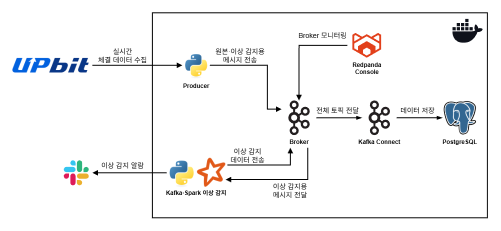

# Crypto Alert Pipeline
기존 진행했던 프로젝트인 [Upbit Pipeline](https://github.com/DE7-team6-final/upbit-data-pipeline)의 실시간 파이프라인 영역 개선 프로젝트

## 개요
### 프로젝트 진행 배경: **기존 로직의 한계**
이전 프로젝트의 가상화폐 실시간 이상 감지 로직은 다음과 같은 순서로 진행된다.
1. 가상화폐의 실시간 체결 데이터를 1분 간 수집하여 적재하는 과정을 반복
2. Sliding Window 방식으로 적재된 데이터의 5분 이동 평균과 새로 적재된 1분 데이터의 체결가 및 거래량의 평균을 비교
3. 체결가 또는 거래량이 설정한 기준치(%)를 초과하는 경우 알람 발생

이러한 로직은 다음과 같은 **한계점**을 가진다.
- 실시간 처리보다는 **1분 간격의 배치 처리**에 가까움
- 데이터를 수집하는 과정으로 인하여 이상 감지까지 **최대 6분의 지연 발생** 가능
- 데이터의 평균값을 이용하기 때문에 **특정 거래 단위로의 이상 감지가 불가능**

개별 체결(거래) 단위의 실시간 처리를 구현하기 위해 **Kafka Consumer 기반 로직**과 **Spark Streaming**을 이용한 파이프라인을 구성하였다.

### 사용 기술


### 아키텍처 다이어그램

- Upbit에서 수집된 가상화폐 체결 데이터는 Kakfa Broker로 전달된다.
- Broker의 상태는 Redpanda Console을 이용하여 모니터링한다.
- Kafka, Spark로 작성된 이상 감지 로직은 메시지를 구독 및 처리하며 이상 감지된 경우 새로운 토픽으로 발행하며 Slack을 통해 알람을 보낸다.
- Broker에 적재된 메시지들은 Kafka Connect를 이용하여 Postgres DB에 자동으로 적재된다.

---

## 프로젝트 구조
### 디렉터리 구조
```text
crypto_alert_pipeline
   ├── kafka/               # Kafka Broker 및 Kafka App
   │   ├── producer.py
   │   └── kafka_anomaly.py
   ├── kafka-connect/       # Kafka Connect 설정 (Sink)
   ├── spark/               # Spark 설정 및 Spark App
   │   └── spark_anomaly.py
   └── docker-compose.yml   # 전체 컨테이너 통합 실행/관리
```

### 주요 스크립트 기능 및 특징
**producer.py**
- websockets를 이용하여 Upbit로부터 실시간 체결 데이터를 수집
- 수집되는 가상화폐 종목은 4개(BTC, ETH, SOL, XRP)
- 데이터는 원본 `raw_upbit_tickers`과 이상 감지용 `anomaly_upbit_tickers` 두 개의 토픽에 적재
- Upbit 서버 연결 실패 시 지수 백오프 방식을 통해 연결 재시도
- 기본 해시 파티셔닝 방식은 브로커에 빈 파티션이 존재하는 문제가 발생하므로 적재 과정에서 파티션을 직접 매핑함
- Spark의 TimestampType은 밀리초 단위의 타임스탬프 형식을 이해하지 못하는 문제가 존재하여 이상 감지용 데이터는 `raw_timestamp`와 `timestamp` 두 개의 컬럼으로 구분함

**이상 감지 로직**
- 체결가와 거래량 두 항목에 대해 이상 감지 수행
- 가상화폐 종목별로 50개의 거래 정보가 쌓인 순간 이상 감지 시작
- **거래량 이상 감지**
   - history(전체 거래), baseline(이상치 제외) 두 개의 버퍼를 사용
   - 가상화폐는 소수점 단위로 거래되므로 편차가 매우 크기 때문에 baseline 버퍼 기준 MAD(중앙값 절대 편차) 기반 Modified-Z-Score 통계를 활용
   - $|\mathbf{Z-Score}| \ge 5$인 경우 이상 거래로 1차 판단
   - history 버퍼의 평균보다 10배 이상인 경우 최종 이상 거래로 확정
   - history 버퍼는 이상치를 포함하기 때문에 최근 거래량과 유사하다면 이상으로 판단하지 않으며, 이상치가 입력되는 순간 평균이 전체적으로 상승하기 때문에 연속적인 알람을 방지하는 효과가 있음
- **체결가 이상 감지**
   - 모든 체결가 정보를 포함하는 단일 버퍼를 사용
   - 단일 버퍼의 평균과 새로운 체결가를 비교하여 단기간 1% 이상 변동하는 경우 이상 거래로 감지

**spark_anomaly.py**
- Spark Stateful Processing 기반 이상 감지
- 윈도우 기반 집계 방식 대신 필요한 값만 저장할 수 있는 상태 기반 처리 방식으로 구현
- 이전 체결가, 거래량(전체 거래량, 이상치 제외 거래량)을 저장하는 상태 변수를 사용
- Spark의 Row 객체를 이용하는 transformWithState 메소드는 Pandas를 사용하지 않아 Python <-> JVM 오버헤드를 줄일 수 있음
- 이상 감지된 데이터는 `spark_anomaly` 토픽으로 재적재
- 체크포인트를 활용하여 상태 변수와 오프셋을 기록하여 프로그램 재시작 시 기존 정보 유실 방지 설정

**kafka_anomaly.py**
- Kafka Consumer 기반 이상 감지
- 이상 감지 로직은 `spark_anomaly.py`와 동일
- Spark의 상태 변수에 해당하는 요소는 전역 변수로 대체 구현
- 이상 감지 시 Slack으로 알림 전송
- 이상 감지된 데이터는 `kafka_anomaly` 토픽으로 재적재
- Spark의 체크포인트와 같은 기능이 따로 구현되어있지 않아 프로그램을 재시작하는 경우 기존 정보를 읽을 수는 없음

---

## 실행 방법

1. 리포지토리 복제
   - 적절한 경로에 디렉터리를 생성한 후 리포지토리를 복제한다.
   ```bash
   git clone https://github.com/Kairo0628/crypto_alert_pipeline
   cd crypto_alert_pipeline
   ```

2. 환경 변수 설정
   - `kafka/` 디렉터리 하위에 `.env` 파일을 생성하고, Slack 알람을 위한 Webhook URL을 추가한다.
   ```bash
   SLACK_URL=https://hooks.slack.com/services/...
   ```

3. Kafka Connect 플러그인 다운로드
   - Kafka와 PostgreSQL를 연동하기 위해 Confluent의 JDBC Connector를 다운로드한다.
      - https://www.confluent.io/hub/confluentinc/kafka-connect-jdbc
   - 스키마 없는 메시지를 커넥터로 전달하기 위해 SchemalessJsonConverter를 다운로드한다.
      - https://github.com/natengall/connect-schemaless-json

   - `kafka-connect/` 디렉터리 하위에 `jdbc`라는 이름의 폴더를 생성한다.
   - 다운로드한 `.jar` 파일들을 생성한 `jdbc` 폴더에 넣는다.


4. 컨테이너 실행
   - 프로젝트 루트 폴더(`docker-compose.yml` 파일의 위치)에서 전체 컨테이너를 실행한다.

   - 최초 실행 시
   ```bash
   docker compose up -d --build
   ```

   - 이후 실행 시
   ```bash
   docker compose up -d
   ```

5. Kafka Connect 등록
   - 컨테이너가 정상적으로 실행되었다면 Postgres Sink Connector를 등록한다.
   ```bash
   curl -X POST http://localhost:8083/connectors \
      -H "Content-Type: application/json" \
      --data @kafka-connect/postgres-sink.json
   ```

6. 실행 확인
   - Redpanda Console: http://localhost:8080
      - 메인 페이지에서 브로커 연결 상태 확인 가능
      - 화면 좌측 바의 Topics 탭에서 토픽 생성 및 메시지 저장 여부 확인 가능
   - Adminer: http://localhost:8088
      - DB - PostgreSQL
      - 서버/사용자이름/비밀번호/데이터베이스: postgres 입력
      - 토픽과 동일한 이름의 테이블이 생성되었는지, 데이터가 적재되는지 확인 가능
